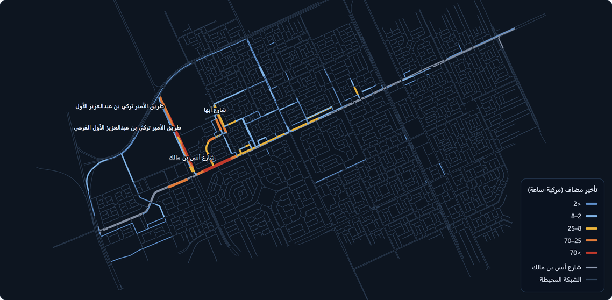

# انسياب — نموذج أولي

مقارنة أثر سيناريوهات أعمال الطرق على شبكة الرياض، من تشغيلات SUMO محفوظة.
INFIRAD Holding · GovJam 2026

المشروع يقيس سؤالًا واحدًا: **إذا أُغلق تقاطع أنس × تركي، أين يذهب التأخير؟ وهل تسترده تحويلة؟**
كل رقم في الواجهة يعود إلى مجلد تشغيل في `runs/`، ولا رقم مكتوب بلا مصدر.

## التشغيل

```bash
python -m http.server 8907 --bind 127.0.0.1
# ثم افتح http://127.0.0.1:8907
```
البيانات والمعالجة كلها في المتصفح — لا خادم خلفي، لا مفاتيح، لا اتصال خارجي.

## ما يعرضه النموذج

| المتطلب | أين | ما يفعله |
|---|---|---|
| واجهة | التاب الأول | سبعة تبويبات، أرقام مقيسة، فحص ذاتي ظاهر |
| عرض الطريق | تاب «الطريق» | 8,488 ضلعًا من شبكة SUMO، الممر، وطبقة تأخير لكل ضلع |
| آلية اختبار | تاب «المختبر» | مقترح حر ⇒ يُطابق أحد الأذرع المقيسة أو يخرج بـ«غير مقيس» |
| تحليل ذكاء اصطناعي | تاب «التحليل» | قراءة آلية مسنودة + محرّك حواري + طبقة لغوية اختيارية بمفتاحك |
| صور أثر التغيير | تاب «الأثر بالصور» | 3 لقطات للطريق قبل/بعد + 4 رسوم مولّدة من التشغيلات |
| **تحقق ميداني** | تاب «التحقق الميداني» | قياس مسجَّل من مركبة حقيقية مقابل الشبكة + جدول انحراف + فيديو إعادة التشغيل |



## الأرقام الأساسية

| القياس | خط الأساس | الإغلاق | الإغلاق + تحويلة |
|---|---|---|---|
| زمن الرحلة (دقيقة) | 19.18 ± 1.44 | 36.04 ± 1.52 | 35.90 ± 1.19 |
| السرعة المتوسطة (كم/س) | 38.4 | 30.2 | 29.8 |
| تأخير مضاف (مركبة‑ساعة) | 0 | 1,985.1 | 1,962.4 |
| صافي التأخير الداخلي (مركبة‑ساعة) | 0 | 1,777.7 | 1,697.1 |
| أضلاع متأثرة | 0 | 664 | 688 |

- **89.6%** من التأخير يبقى داخل شبكة الممر: الإغلاق ينقل الضغط ولا يُذيبه.
- التحويلة تسترد **265.4** مركبة‑ساعة (توفير **4.5%**) — تحسّن حقيقي لكنه صغير أمام حجم الأثر.
- ثلاثة شوارع تحمل **58.2%** من التأخير المضافة.
- الذراع الضابط (`identity`: نفس الإعداد بلا إغلاق) يعطي **0.0** — فالأثر أثر التدخّل لا البذور.

## التحقق الميداني (قياس حقيقي ضد الشبكة)

قياس مسجَّل من **Mazda CX‑5 2024** بمسجّل **ESP32‑S3 + GNSS u‑blox على CAN/OBD** بتردد **1 هرتز**
(`MZ-CX5-TRIP-025` · بطاقة SD) في **2026‑11‑14** بين **18:23:38Z و20:47:48Z** (توقيت UTC):
**3,002** نقطة، مسار **35.9 كم**، منها **16.0 كم** تسجيل متصل بلا فجوات، و**119** فجوة تسجيل (30 ثانية)
لا تُقاس هندسيًا ولا تُملأ بالتخمين.

| القياس | القيمة | كيف حُسب |
|---|---|---|
| **دقة طول المسار** | **97.8%** | 8,951.1 م ميدان مقابل 8,754.1 م على الشبكة (خطأ −2.2%) على 17 مقطعًا متصلًا |
| نقاط ضمن 30 م من الشبكة | 84.5% | 2,537 من 3,002 · وسيط الانحراف 4.34 م · p90 10.2 م |
| متوسط خطأ المقطع | 5.21% | وسيط 1.7% · أسوأ مقطع 37.0% |
| بلا شرط الحركة الفيزيائية | 67.3% | 11,880.3 م ⇒ 46% أطول: الشبكة تفرض مسارًا مخالفًا للمقيس |

كل هذه الأرقام **مولّدة** لا مكتوبة: `data/accuracy_final.json` ⇒ `build/build_validation.py` ⇒
`data/validation.json` ⇒ الواجهة. والبوابة ترفض أي رقم مُدخل يدويًا:

```bash
python build/verify_validation.py   # exit 3 إن خالف رقمٌ خط الإنتاج أو ظهر رقم مكتوب بيد
```

الحدود معلنة داخل التاب نفسه: مقطع واحد، مركبة واحدة، وليلة واحدة — لا استدلال إحصائي.

## التحقق

```bash
python build/verify_brief.py     # يفحص كل رقم في data/ai_brief.md مقابل data/ai_facts.json
```
يفشل برمز 3 إذا ورد رقم غير مسنود. القراءة المعروضة في تاب «التحليل» مرّت هذا الفحص:
**41/41 رقمًا مسنود**، والواجهة تعرض حالة الفحص نفسها (شارة تحت القراءة).

داخل التطبيق: فحص ذاتي يعمل عند الإقلاع ويقارن أرقام الشاشة بـ`data/canon.json`
(12 فحصًا، نتيجته ظاهرة في التاب الأول). وأي رقم محظور (`data/canon.json → banned`)
يُنبَّه عليه في الواجهة نفسها.

## إعادة التوليد من التشغيلات

البيانات المُشتقّة مضمّنة في `data/`، فلا حاجة لهذه الخطوات للتشغيل. لإعادة بنائها:

```bash
# يحتاج SUMO 1.27.0 ومجلد التشغيلات: INSIYAB_MODEL/runs
python build/extract_network.py    # ⇒ data/network.json    (هندسة من insyab.net.xml)
python build/extract_arms.py       # ⇒ canon/arms/damage/trips.json
python build/make_figures.py       # ⇒ images/04–07 + data/figures.json
python build/make_facts.py         # ⇒ data/ai_facts.json
python build/verify_brief.py       # ⇒ data/ai_brief_status.json
```

## البنية

```
index.html            واجهة واحدة RTL، سبعة تبويبات
assets/app.js         العرض والخريطة والمختبر والفحص الذاتي
assets/style.css      ألوان INFIRAD (#0A2463 · #8D99AE)
data/network.json     8,488 ضلعًا · 1,169 شارعًا · إحداثيات جغرافية
data/{canon,arms,damage,trips}.json   الأرقام ومصدرها
data/ai_brief.md      القراءة الآلية + status الفحص
images/               01–03 لقطات الطريق · 04–07 رسوم
assets/validation.js   تاب التحقق الميداني (يقرأ JSON فقط، لا رقم فيه)
data/accuracy_final.json   نتيجة مطابقة المسار الميداني بالشبكة
data/validation.json       نفسها في شكل بطاقات وجداول (مولّد)
media/                     insiyab_replay.mp4 (70 ث) + poster.jpg
build/build_validation.py  JSON ⇒ validation.json
build/verify_validation.py بوابة أرقام التاب (exit 3)
build/                سكربتات الاستخراج والفحص
```

## الحدود

- التأخير المضاف ليس كلفة مالية؛ التحويل إلى ريال يحتاج قيمة ساعة مركبة محلية لم تُقس هنا.
- السياسة تغيّر النتيجة: بحدّ انتظار 600 ثانية يصبح متوسط الرحلة 26.26 دقيقة بدل 19.18.
- تعريف الممر شُغّل على خط الأساس فقط؛ لا رقم لزمن عبور الممر بعد الإغلاق.
- كل مقارنة بين سيناريوهين تجري داخل سياسة قياس واحدة، وإلا قيست أثر السياسة لا أثر المقترح.
